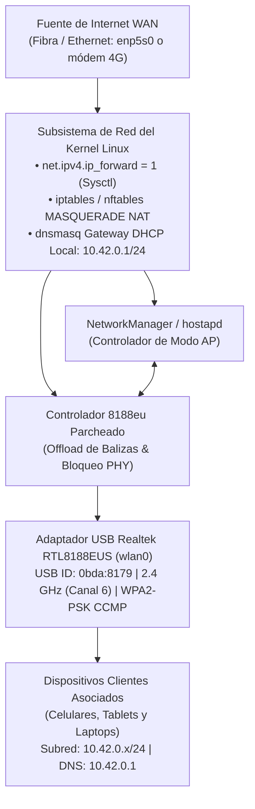

# Baliza 📡 Linux 802.11 AP Engine & Modern RTL8188EUS Kernel Port

<p align="center">
  
  
  
  
</p>

```
    ____        ___                
   / __ )____ _/ (_)___  ____ _    
  / __  / __ `/ / /_  / / __ `/    
 / /_/ / /_/ / / / / /_/ /_/ /     
/_____/\__,_/_/_/ /___/\__,_/      
 LINUX 802.11 AP ENGINE & RTL8188EUS SUITE
```

> **Baliza** (*Spanish for "Beacon"*) enables stable **Access Point (AP / Master) mode** on USB Wi-Fi dongles powered by the **Realtek RTL8188EUS** chipset under modern Linux distributions. It bundles kernel-level compatibility patches for Linux 6.x and 7.x, disables USB auto-suspend drops, provides an interactive CLI dashboard with real-time ARP telemetry, and renders instant pairing QR codes directly in the terminal.

---

## 🔬 El Problema Técnico y la Solución

El chipset Realtek RTL8188EUS (USB ID `0bda:8179`) es uno de los adaptadores inalámbricos de bajo costo más extendidos, pero presenta incompatibilidades críticas en distribuciones Linux modernas al intentar utilizarlo como punto de acceso:

| Problema en Linux Moderno | Diagnóstico y Síntoma | Solución Implementada en Baliza |
| :--- | :--- | :--- |
| **`rtl8xxxu` falla en modo AP** | El driver in-tree `rtl8xxxu` (mac80211) no gestiona el hardware queue de tramas de baliza (*Beacon Frames*) en el RTL8188EUS. El BSS no emite balizas periódicas y arroja timeouts en `NL80211_CMD_START_AP`. | **Driver `8188eu` optimizado**: Se desactiva `rtl8xxxu` en modprobe y se compila el módulo `8188eu` con soporte completo de balizas por hardware en modo Master/AP. |
| **Ruptura de compilación en Linux 6.x y 7.x** | Deprecación de `del_timer_sync` en Linux 6.15+, migración de `net_device` a `wireless_dev` en `cfg80211_ops` (Linux 7.1+), y cambios de firma en `remain_on_channel` (Linux 7.2/7.3). | **Parches quirúrgicos documentados**: Árbol de código parcheado y probado en `Linux 7.2.11-arch1-1`. Diffs aislados disponibles en [`patches/`](patches/). |
| **Desconexiones fortuitas (Ghost drops)** | El subsistema USB entra en suspensión selectiva agresiva (*auto-suspend*) tras inactividad del enlace de radio, congelando el frontend de RF. | **Bloqueo PHY por opciones de módulo**: Parámetros persistentes `rtw_power_mgnt=0 rtw_ips_mode=0 rtw_enusbss=0` en `/etc/modprobe.d/8188eu.conf`. |
| **Complejidad de emparejamiento** | Escribir contraseñas WPA2 complejas en dispositivos móviles es tedioso y propenso a errores. | **Código QR ANSI en Terminal**: Generador compatible con el estándar Wi-Fi Alliance (`baliza qr`) para escaneo directo con cámara móvil. |
| **Falta de visibilidad de red** | Dificultad para auditar quién está asociado y cuánto ancho de banda consume. | **Monitor HUD en vivo**: Detección de estaciones en tiempo real mediante tablas ARP del kernel y contadores de paquetes RX/TX. |

---

## 📊 Matriz de Hardware y Entorno Verificado

Las capacidades del driver y la estabilidad del modo AP fueron verificadas en laboratorio con el siguiente hardware:

| Componente | Especificación Verificada |
| :--- | :--- |
| **Chipset Wi-Fi** | Realtek RTL8188EUS 802.11n Wireless Network Adapter |
| **USB ID (lsusb)** | `0bda:8179 Realtek Semiconductor Corp.` |
| **Kernel Linux** | `7.2.11-arch1-1` (x86_64) |
| **Distribución** | EndeavourOS / Arch Linux (Rolling Release) |
| **Modos de Interfaz (`iw list`)** | `IBSS`, `managed`, `AP`, `monitor`, `P2P-client`, `P2P-GO` |
| **Cifrados Soportados** | WEP40, WEP104, TKIP, CCMP-128 (WPA2-PSK) |
| **Tasa de Enlace PHY** | Hasta 150 Mbps (HT40) / 72.2 Mbps (HT20) en 2.4 GHz |
| **Informe Técnico Completo** | [docs/TECHNICAL_REPORT.md](docs/TECHNICAL_REPORT.md) |

---

## 📐 Arquitectura de Red y Flujo de Tráfico



---

## 🚀 Instalación y Puesta en Marcha

Baliza incluye un instalador automatizado compatible con **Arch Linux, EndeavourOS, Debian, Ubuntu, Fedora y Raspberry Pi OS**:

```bash
git clone https://github.com/ExeDevCentral/Baliza.git
cd Baliza
sudo ./install.sh
```

### Operaciones ejecutadas por el instalador:
1. Comprueba e instala dependencias de compilación (`base-devel`, `dkms`, `networkmanager`, `qrencode`).
2. Configura `/etc/modprobe.d/` para bloquear `rtl8xxxu` y desactivar los modos de bajo consumo del `8188eu`.
3. Compila el driver inalámbrico contra las cabeceras de tu kernel actual e instala el módulo `.ko`.
4. Instala el comando `baliza` en `/usr/local/bin/` (junto con alias de compatibilidad `airforge` y `hotspot`).
5. Habilita el reenvío IPv4 (`net.ipv4.ip_forward = 1`) y configura el servicio systemd.

---

## 💻 Matriz de Comandos CLI (`baliza`)

```bash
baliza status              # Muestra el panel HUD: estado del módulo, radio, gateway y clientes activos
baliza qr                  # Renderiza el código QR para emparejamiento móvil instantáneo
baliza monitor             # Monitor dinámico en vivo con tasa de transferencia y clientes (refresco cada 2s)
baliza clients             # Tabla de estaciones asociadas (IP, MAC y hostname)
baliza traffic             # Estadísticas acumuladas de transferencia RX/TX (MB y paquetes)
baliza config "SSID" "PW"  # Modifica interactivamente el nombre de red y la clave WPA2
baliza on                  # Inicia la transmisión del AP y el enrutamiento NAT
baliza off                 # Detiene el punto de acceso de forma segura
baliza restart             # Reinicia la interfaz inalámbrica y el ruteo
baliza rebuild             # Recompila e instala el módulo tras una actualización de kernel
baliza service [action]    # Administra el daemon systemd (enable | disable | status | start | stop)
```

*(Nota: Los comandos heredados `airforge` y `hotspot` se mantienen como enlaces simbólicos para compatibilidad).*

---

## 📱 Emparejamiento Rápido con Código QR

Al ejecutar `baliza qr`, el sistema renderiza un código QR UTF-8 estándar (`WIFI:T:WPA;S:...;P:...;;`):

```bash
baliza qr
```

Apuntá la cámara de cualquier teléfono Android o iPhone hacia la terminal para asociarte a la red al instante sin ingresar credenciales manualmente.

---

## ⚠️ Limitaciones Conocidas y Modelo de Amenazas

Para mantener el rigor técnico, se declaran explícitamente las siguientes restricciones operativas y de seguridad:

1. **Sin soporte WPA3 / SAE:**  
   El hardware del RTL8188EUS no incorpora aceleración por silicio para el protocolo SAE (WPA3-Personal) ni ciphers GCMP/CCMP-256. La red opera bajo **WPA2-PSK (AES/CCMP-128)**.
2. **Exposición de Credenciales:**  
   - El código QR en terminal visualiza la contraseña en texto plano ante observadores físicos directos (*shoulder surfing*).
   - El subcomando `baliza config SSID PASSWORD` expone los argumentos al historial de shell (`~/.bash_history`). Se recomienda dejar un espacio inicial antes del comando o utilizar comillas seguras.
3. **Banda Única 2.4 GHz (802.11b/g/n):**  
   No posee radio de 5 GHz. Está sujeto al ruido e interferencias propias de la banda de 2.4 GHz (hornos microondas, Bluetooth, saturación de canales contiguos 1, 6 y 11).
4. **Aislamiento de Clientes:**  
   Por defecto, las estaciones asociadas al AP comparten el mismo dominio de broadcast de capa 2 (`10.42.0.0/24`). Si se requiere aislamiento para redes públicas de invitados, deben configurarse reglas adicionales con `nftables` o `ebtables`.

---

## 🧭 Estado del Proyecto y Roadmap

### Fase 1: Estabilidad de Kernel y Modo AP Core (v1.0 – v1.2) ✅
- [x] Parches de compatibilidad probados en Linux 6.x y 7.x (`7.2.11-arch1-1`).
- [x] Bloqueo determinista de `rtl8xxxu` y anulación de suspensión USB.
- [x] Modo AP funcional con balizas de hardware en 2.4 GHz WPA2-PSK.
- [x] Reenvío IPv4 y ruteo NAT masquerade transparente.
- [x] HUD de terminal, generador QR y monitor de tráfico en vivo.
- [x] Suite de diffs aislados en `patches/` e informe técnico en `docs/TECHNICAL_REPORT.md`.

### Fase 2: Automatización DKMS y Calidad de Código (Planificado)
- [ ] Integración completa con DKMS para recompilación transparente en updates de kernel.
- [ ] Linteo continuo con ShellCheck y validaciones en GitHub Actions.
- [ ] Paquetes de distribución nativos: Arch User Repository (AUR) y Debian/Ubuntu `.deb`.

### Fase 3: Soporte Multi-Chipset (Planificado)
- [ ] Soporte para adaptadores de doble banda Realtek RTL8812AU / RTL8821AU (AC 1200).
- [ ] Detección automática de VID:PID en caliente mediante reglas de udev.

---

## 📜 Licencia y Atribución

Este proyecto y sus herramientas de orquestación se distribuyen bajo los términos de la **GNU General Public License v2.0 (GPL-2.0)** para preservar la conformidad con el kernel Linux.

### Créditos y Fuentes Upstream:
- **Driver Base:** [aircrack-ng/rtl8188eus](https://github.com/aircrack-ng/rtl8188eus) (v5.3.9) — Mantenido por el equipo de Aircrack-ng, Realtek y Alfa Networks.
- **Parches para Kernel 6.x / 7.x & Orquestador CLI:** Desarrollado por [Exequiel Echevarria (ExeDevCentral)](https://github.com/ExeDevCentral).
- *Rosario, Argentina.*
