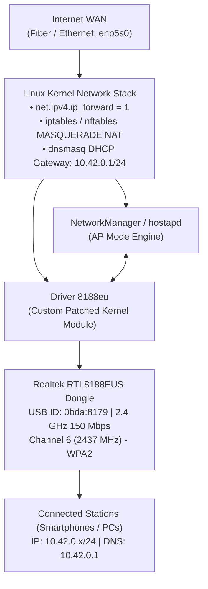

# Architecture & Technical Deep Dive 🛠️

This document describes the architectural flow, kernel interactions, and networking pipeline utilized by **Baliza**.

---

## High-Level Topology



---

## Key Engineering Decisions

### 1. In-Tree `rtl8xxxu` vs. Custom `8188eu`
The Linux kernel includes an open-source driver named `rtl8xxxu`. While functional for basic client connections and passive monitor mode, it lacks reliable Master/AP (Access Point) mode support for the RTL8188EUS chipset (`0bda:8179`). Under `rtl8xxxu`:
- The hardware beacon queue fails to emit 802.11 management frames (beacons) at regular intervals.
- `NL80211_CMD_START_AP` calls experience timeouts during BSS startup.
- Mobile clients fail to discover the SSID or disconnect due to beacon loss.

Baliza resolves this by:
- Blacklisting `rtl8xxxu` in `/etc/modprobe.d/blacklist-rtl8xxxu.conf`.
- Installing the `8188eu` vendor-HAL module with hardware beacon offloading and AP mode support.

### 2. Aggressive Power Management Elimination
Budget Realtek USB dongles enter aggressive low-power sleep mode after brief periods of radio inactivity, dropping client associations and causing interface freezes. Baliza permanently passes:
```ini
options 8188eu rtw_power_mgnt=0 rtw_ips_mode=0 rtw_enusbss=0
```
This forces the USB PHY and radio baseband to maintain constant link presence.

### 3. Kernel 6.x and 7.x Compatibility
Upstream driver trees fail to build on Linux 6.x/7.x due to:
- Replacement of `del_timer_sync` by `timer_delete_sync` in Linux 6.15+.
- Signature transitions in `cfg80211_ops` (e.g. `cfg80211_rtw_add_key` receiving `struct wireless_dev *wdev` in Linux 7.1+).
- Refactored `remain_on_channel` parameters in Linux 7.2 and 7.3.
- Deprecation of `strncpy` in favor of `strscpy` in Linux 7.2+.

Baliza bundles discrete, documented patches in `patches/` tested against Linux `7.2.11-arch1-1`.
